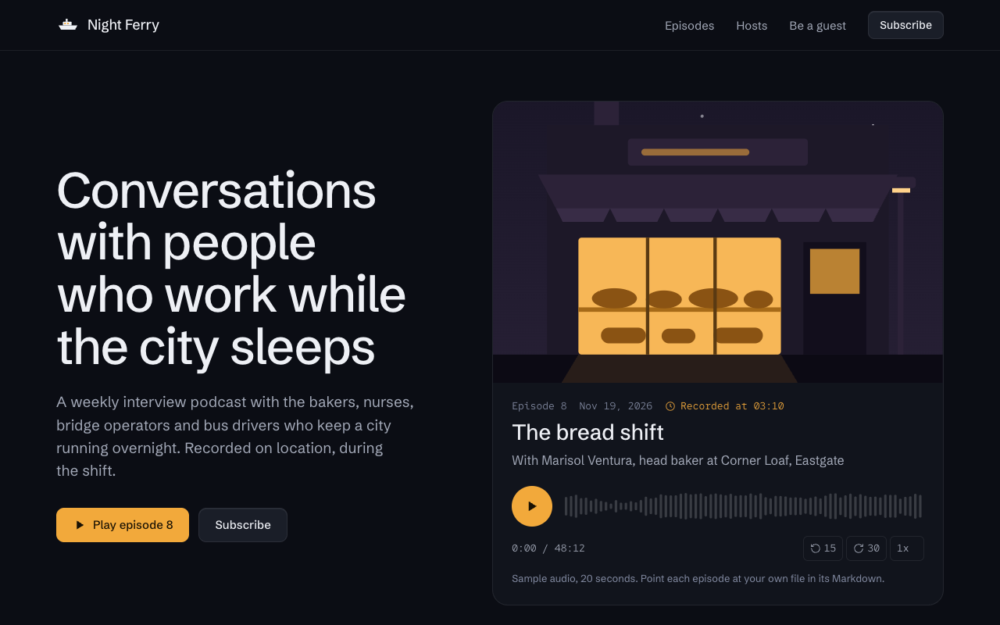

# Night Ferry: Astro podcast website template

A podcast website with a built-in episode player, a show notes page for each episode, hosts, subscribe links, an RSS feed for podcast apps and a newsletter form. It builds to a static site.



[](https://console.cloudzyro.com/new?repo=https://github.com/Cloudzyro/template-podcast)

## What's included

- Home page with the latest episode and its player, recent episodes, hosts, subscribe links and a newsletter signup
- An episode list grouped by season, with instant search by title, guest or place
- A page for every episode with show notes in Markdown, clickable chapters that jump the player to that point, links mentioned in the episode, and previous and next episodes
- An audio player built on the browser's own audio element: play and pause, seek on a waveform, back 15 and forward 30 seconds, and playback speed. The audio only downloads when someone presses play
- Optional embedded player per episode (Spotify, YouTube or your host's player) that only loads when a visitor clicks to load it
- A podcast RSS feed at `/rss.xml` with Apple Podcasts tags (cover, category, duration, season and episode numbers, audio enclosures), ready to submit to podcast directories
- About page with hosts and a "Be a guest" form
- Cover art drawn in code for each episode, so there are no images to license, plus a square show cover in `public/cover.png`
- Structured data for the series and each episode, Open Graph tags, sitemap, robots.txt and favicon
- Responsive down to 360px, keyboard friendly, reduced motion respected

## Run it locally

```bash
pnpm install
pnpm dev        # http://localhost:4321
pnpm build      # static site in dist/
pnpm preview    # serve the built site
```

## Make it yours

- **Show details:** `src/data/show.ts` holds the name, tagline, description, hosts, subscribe links, newsletter text, emails and the feed settings (author, category, explicit flag, cover image).
- **Episodes:** one Markdown file per episode in `src/content/episodes/`. The frontmatter holds the title, number, season, date, duration, guest, summary, chapters and links; the body is the show notes. The file name becomes the address, so `the-bread-shift.md` is `/episodes/the-bread-shift/`.
- **Audio:** point each episode's `audio.url` at your episode file (usually an MP3 on your podcast host), and set `audio.bytes` to its size and `audio.type` to `audio/mpeg`. Podcast apps read these from the RSS feed. The template ships with one 20-second sample (`public/audio/night-ferry-sample.wav`, made by `pnpm sample-audio` from math, so it's free to use); delete it once your episodes point elsewhere.
- **Embedded player:** add `embedUrl` to an episode (for example a Spotify episode embed address) to offer a "Load the player" button under the built-in one. Nothing from that service loads until it's clicked.
- **Subscribe links:** replace the `#` links in `show.subscribe` with your show's pages on Apple Podcasts, Spotify and the rest. An empty link hides that service.
- **Cover art:** `src/components/Cover.astro` draws each episode's night scene; pick one per episode with `cover`. To use your own artwork, swap the component for an ``. Replace `public/cover.png` (at least 1400 x 1400) with your show's square artwork for podcast apps, and `public/og.png` (1200 x 630) for social previews.
- **Forms:** set `PUBLIC_FORM_ENDPOINT` to a form endpoint from Formspree, Basin, a Supabase function or similar. The newsletter form sends `email`; the guest form sends `name`, `email`, `work`, `hours` and `message`. Each also sends `form` (`newsletter` or `guest`). With no endpoint set, the forms show a short note and open the visitor's email app addressed to the emails in `show.ts`.
- **Site address:** set `SITE_URL` (for example `https://www.nightferry.fm`) so the RSS feed, sitemap and social previews use your domain. The feed needs full addresses, so set this before submitting it.
- **Colors and fonts:** colors are CSS variables at the top of `src/styles/global.css`. Fonts are Schibsted Grotesk and Red Hat Mono, self-hosted with Fontsource and imported in `src/layouts/Base.astro`.

Environment variables are read at build time. Locally, put them in `.env`:

```bash
PUBLIC_FORM_ENDPOINT=https://formspree.io/f/your-id
SITE_URL=https://www.nightferry.fm
```

## Deploy

Click the Deploy button above, or push your own copy to GitHub and connect it in the Cloudzyro console. Add the environment variables in your site's settings. The build command is `pnpm build` and the output folder is `dist/`, a plain static site.

## Stack

- Astro 7 (static output)
- Astro content collections for episodes
- @astrojs/rss and @astrojs/sitemap
- TypeScript

MIT licensed. See [LICENSE](./LICENSE).
